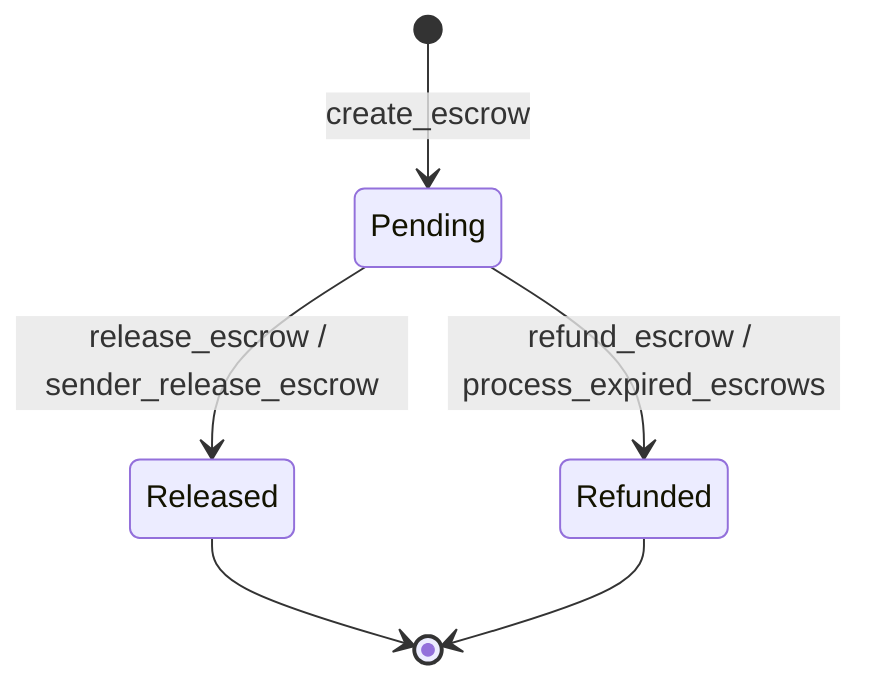

# Escrow lifecycle

SwiftRemit supports a standalone on-chain escrow lifecycle. An escrow begins in `Pending` and ends in either `Released` (recipient paid) or `Refunded` (sender repaid). These are terminal states: an escrow cannot be released or refunded a second time.

## State diagram

## Actions and authorization

| Public entry point | Who may call it | When permitted | Result / event |
| --- | --- | --- | --- |
| `create_escrow(sender, recipient, amount, token)` | Authenticated **sender** | Contract not paused or migrating; positive amount; sender/recipient checks, token whitelist/KYC and transfer limits apply | Stores a `Pending` escrow; emits `escrow_created` |
| `release_escrow(transfer_id)` | Contract **admin** | Existing `Pending` escrow; contract must not be paused; recipient checks apply | Transfers escrow to recipient, sets `Released`; emits `escrow_released` |
| `sender_release_escrow(transfer_id)` | Authenticated original **sender** | Existing `Pending` escrow; contract must not be paused; recipient checks apply | Releases to recipient, sets `Released`; emits `escrow_released` |
| `refund_escrow(transfer_id)` | Authenticated original **sender** | Existing `Pending` escrow with an expiry and ledger time **at or after** expiry; allowed while paused | Refunds to sender, sets `Refunded`; emits `escrow_refunded` |
| `process_expired_escrows(transfer_ids)` | **Anyone** (permissionless) | Can be called while paused; processes only `Pending` escrows with an expiry and ledger time **strictly after** expiry | Refunds eligible escrows, returns processed IDs, emits `escrow_refunded` per refund |
| `extend_escrow_expiry(transfer_id, new_expiry)` | Authenticated escrow **recipient** | Existing `Pending` escrow; contract must not be paused; new expiry must be later than current expiry | Changes expiry; emits escrow expiry-extension event |
| `update_escrow_ttl(ttl)` | Contract **admin** | Runtime configuration change | Affects expiry on **new** escrows; emits `config_updated` with key `esc_ttl` |

`create_escrow` accepts an optional token address; `None` chooses the configured USDC token. A chosen token must be whitelisted. An escrow's asset is recorded on creation and used when refunding. See [`src/lib.rs`](../src/lib.rs) for detailed validation and stored-record fields.

## TTL, expiry and timing

- **Global escrow TTL defaults to `0`** at initialization. A TTL of `0` means `expiry = None`: the escrow does **not** expire automatically. The sender cannot use the time-based `refund_escrow` path when there is no expiry. Admin or sender release remains available.
- For a positive TTL, the new escrow stores `expiry = creation ledger timestamp + TTL` (in seconds). Updating the global TTL later does **not** rewrite already-created escrows.
- **At exactly the expiry timestamp**, `refund_escrow` may succeed (`now >= expiry`). `process_expired_escrows` uses a stricter test (`now > expiry`), so the batch processor only includes it after that instant.
- **Expiry does not automatically transfer funds**: an eligible sender must invoke `refund_escrow`, or any caller must invoke `process_expired_escrows`. A `Pending` escrow may still be released by the authorized releaser until it has actually been refunded; expiry is not itself a `Refunded` state transition.
- Batch processing skips missing, non-pending, not-yet-expired, and non-expiring escrows rather than refunding them. The default expired batch maximum is **50**, and admins can set the corresponding size to **1–200** with `set_max_expired_batch_size`.
- `extend_escrow_expiry` changes the stored expiry for a pending escrow. An extension is not the same as changing the global TTL.

## Behavior while paused

| Allowed while paused | Blocked while paused |
| --- | --- |
| `refund_escrow` (if its other conditions hold) | `create_escrow` |
| `process_expired_escrows` | `release_escrow` |
| Read-only escrow lookups | `sender_release_escrow` and `extend_escrow_expiry` |

This preserves an exit path for funds already held in expired escrows during an emergency pause; it does not grant early refunds for escrows whose expiry has not been reached.

## Events

The implementation defines escrow events in [`src/events.rs`](../src/events.rs). Consumers should identify escrows by transfer ID in the event topics/records.

| Event | Emitted when |
| --- | --- |
| `escrow_created` | A new pending escrow is created (sender, recipient, amount) |
| `escrow_released` | An admin or the sender releases funds to the recipient |
| `escrow_refunded` | The sender or the expiry batch refunds funds |
| Escrow expiry-extension event | Recipient extends an existing expiry |
| `config_updated` (`esc_ttl`) | Admin updates the global TTL; not an individual escrow status change |

## Important errors

| Contract error | Code | Typical cause |
| --- | --- | --- |
| `EscrowNotFound` | 38 | Unknown escrow ID |
| `InvalidEscrowStatus` | 39 | Escrow already `Released` or `Refunded` |
| `EscrowNotYetExpired` | 85 | Sender attempts refund before expiry **or** expiry is absent (`TTL = 0`) |
| `InvalidBatchSize` | 41 | Too many escrow IDs in an expiry-processing batch |
| `ContractPaused` | 13 | Action is blocked during pause |
| `InvalidAmount` | 3 | Zero/negative escrow amount or invalid expiry extension |
| `UserBlacklisted` | 15 | Sender/recipient is blocked by policy |
| `KycNotApproved` / `KycExpired` | 17 / 23 | Required KYC is missing or expired |
| `TokenNotWhitelisted` | 29 | Selected token is not approved |
| `RateLimitExceeded` | 25 | Sender exceeds applicable transfer/rate limit |
| `MigrationInProgress` | 31 | Creation is blocked while migration is active |
| `Unauthorized` | 20 | Caller lacks the necessary authorization |

Other arithmetic, token-transfer and contract initialization errors can also propagate. The definitive sources are [`src/lib.rs`](../src/lib.rs) and [`src/errors.rs`](../src/errors.rs).
